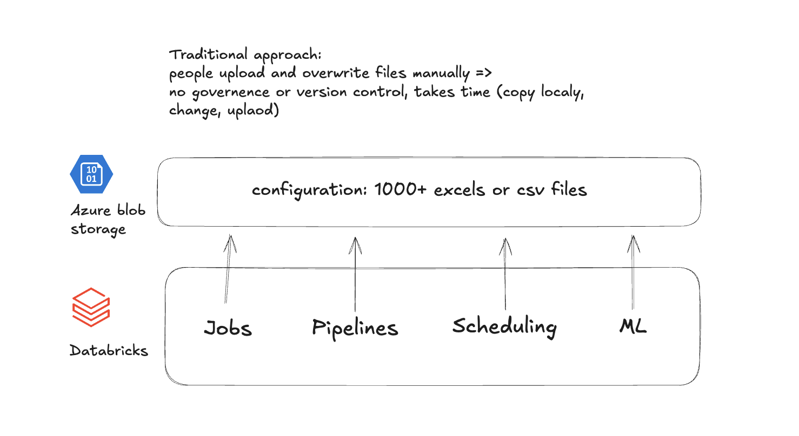
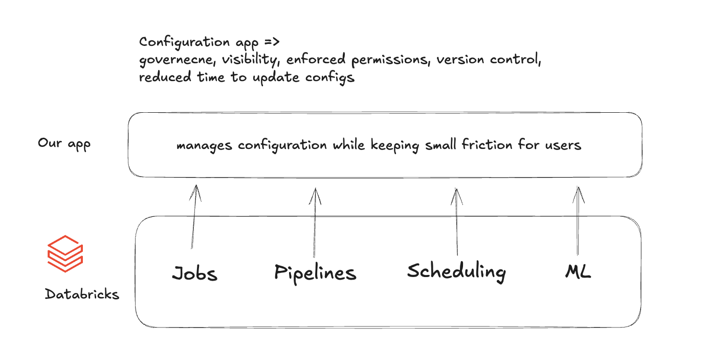
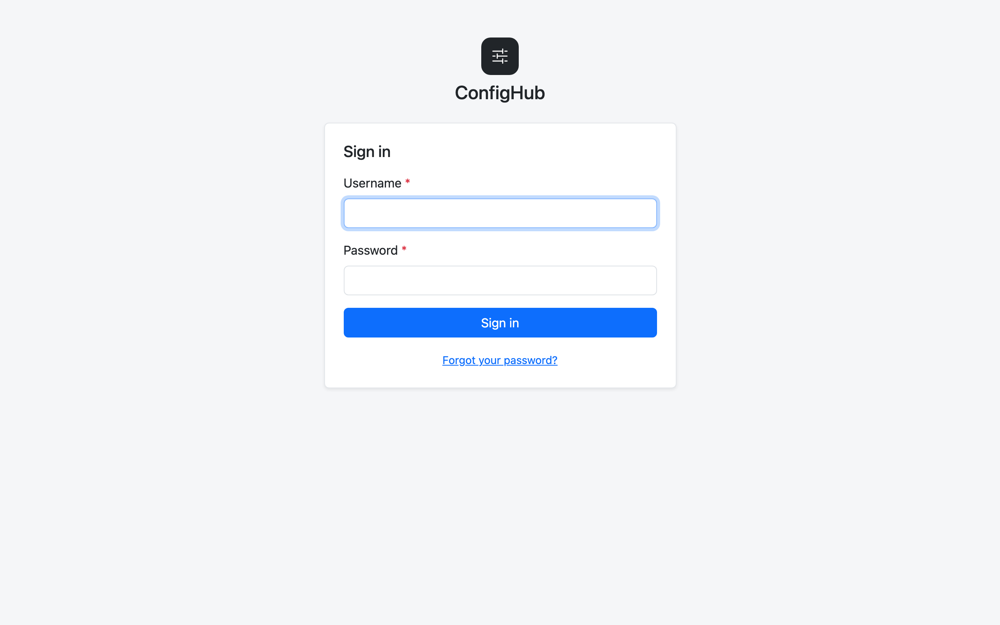
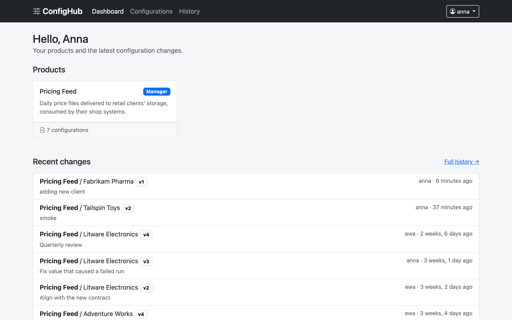
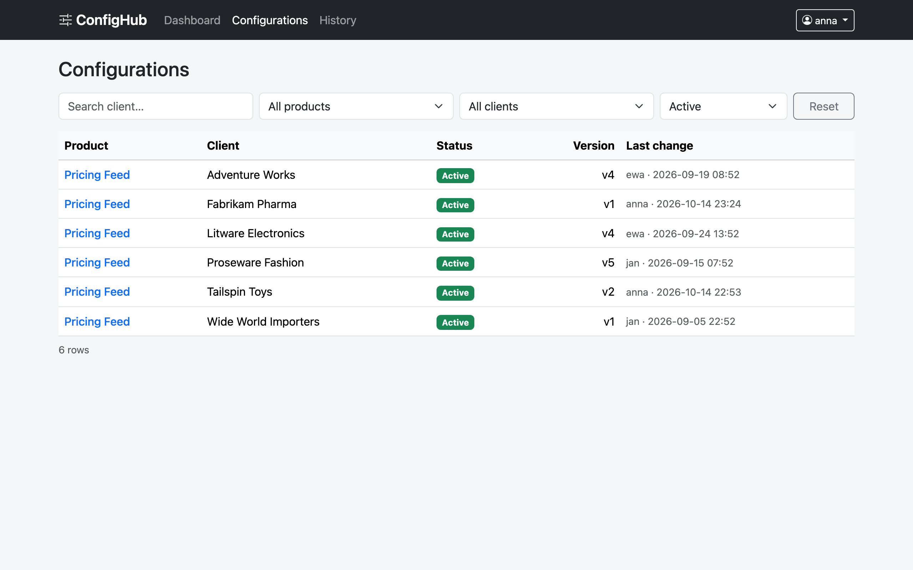
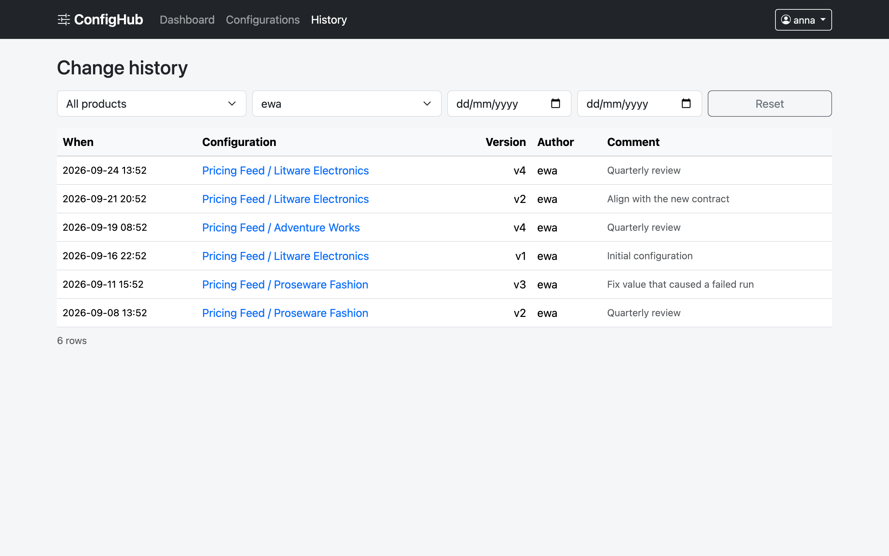
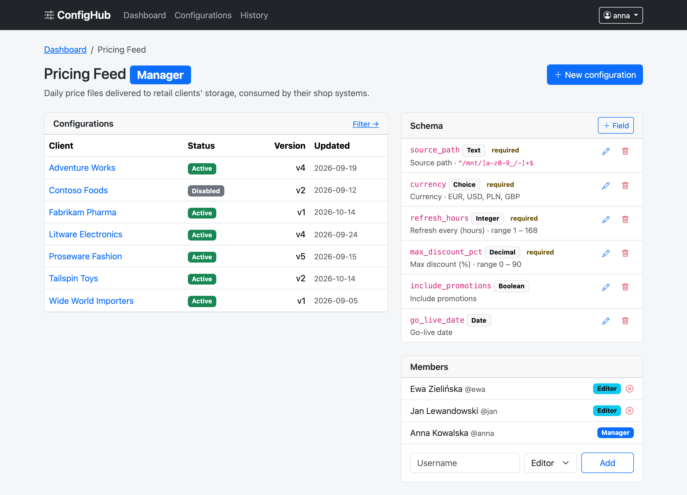
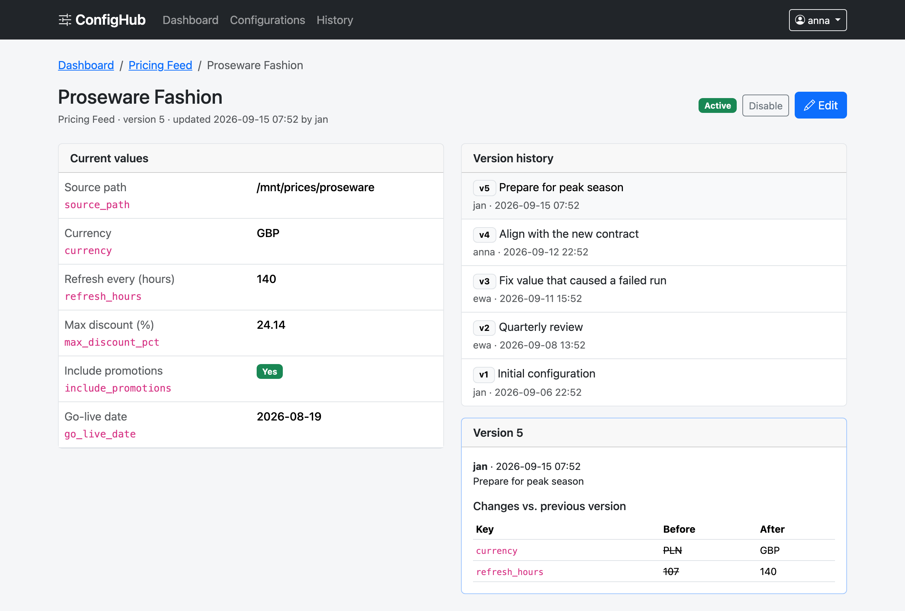
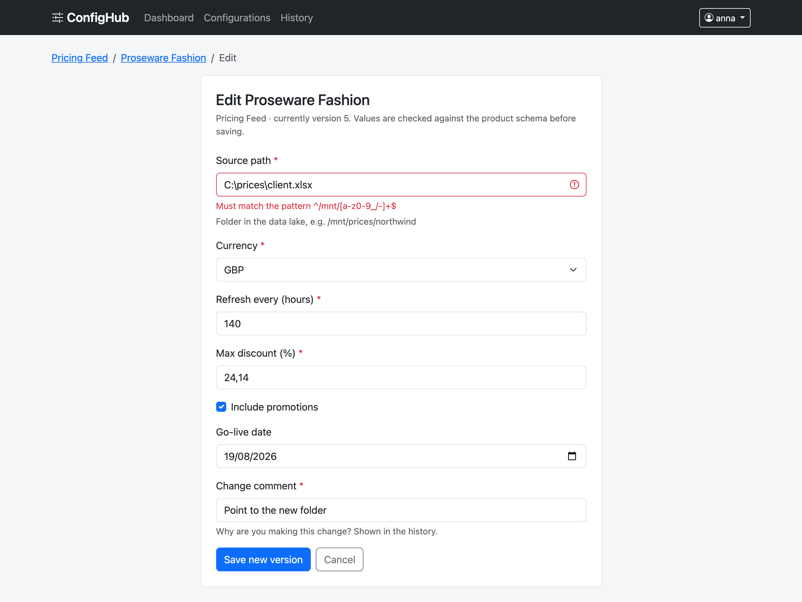
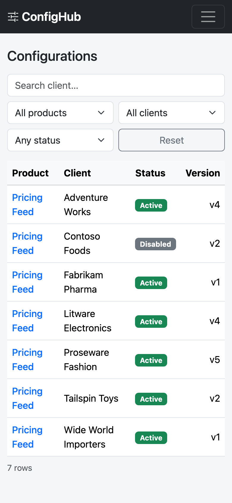

# ConfigHub

**Governed configuration management for a Databricks-based analytics platform.**

> The company, clients and people below are fictional. The problem is a real one, seen on data platforms
> built around Databricks.

**Contents**

- [Part 1 · The business problem](#part-1--the-business-problem)
  - [The company](#the-company)
  - [How configuration is managed today](#how-configuration-is-managed-today)
  - [Why Databricks alone doesn't solve it](#why-databricks-alone-doesnt-solve-it)
  - [The solution: ConfigHub](#the-solution-confighub)
  - [Roles and use cases](#roles-and-use-cases)
  - [Screenshots](#screenshots)
  - [Prototype vs. production](#prototype-vs-production)
- [Part 2 · Technical documentation](#part-2--technical-documentation)
  - [Stack](#stack)
  - [Architecture and dataflow](#architecture-and-dataflow)
  - [Where the logic lives](#where-the-logic-lives)
  - [Project structure](#project-structure)
  - [Run it](#run-it)
  - [Test it](#test-it)
  - [Extend it](#extend-it)

---

## Part 1 · The business problem

### The company

**Northstack Analytics** sells analytics products to mid-size and large companies in retail, consumer goods and
pharma. Each product is a recurring data delivery that runs for a client:

| Product | What the client gets |
|---|---|
| **Pricing Feed** | Daily price files for the client's shop systems, with promotions and discount limits applied |
| **Sales Forecast** | A weekly demand forecast per store and article, used for purchasing and staffing |
| **Inventory Sync** | Stock levels synchronised between the client's warehouses and Northstack's central tables |
| … | about 20 more: assortment analysis, churn models, promotion effectiveness, … |

Everything runs on **Databricks**: ingestion **pipelines**, scheduled **jobs**, **machine learning** models
and, more recently, AI-assisted analysis. Northstack started with a handful of clients and two products. Today it
serves **hundreds of clients** with **more than 20 products**, and **over 100 people** (data engineers, analysts,
client-success managers) work on the platform.

### How configuration is managed today

The pipelines are shared, but **no two clients are the same**. Every product needs per-client settings: where the
source data lives, which currency to use, how often to refresh, discount limits, which forecasting model,
the forecast horizon, the warehouse code, who to notify when a run fails, and so on.

These settings live in **more than a thousand Excel and CSV files on Azure Blob Storage**, which the Databricks
jobs read at run time:



Changing one value means: find the right file, download it, edit it locally, upload it back and hope it was
the latest copy. The result:

- **Mistakes reach production.** A typo in a path or a currency code is only discovered when the nightly job
  fails, and the client's delivery is late.
- **No governance.** Anyone with storage access can change any client's settings. Nobody owns a file.
- **No history.** When something breaks, nobody can tell who changed what, when, or why, or how to roll back.
- **Stale copies.** Files get copied, renamed and re-uploaded; several versions of "the" config exist.
- **It's slow.** A one-value change takes minutes of download/edit/upload, and often a message to an engineer.

### Why Databricks alone doesn't solve it

Databricks is excellent at processing data, but it has **no UI for people to edit data by hand**.

Moving the configuration from files into Delta tables would make it governed and versioned, but it wouldn't make it
editable: there's no screen where a client-success manager opens a table, changes one client's refresh interval
and saves. The only way to change a row is to write SQL (`UPDATE … WHERE client = …`) in a notebook or the SQL
editor. That's too much friction for the 100+ people who maintain configurations, many of whom don't write SQL, and
nothing checks the new value against business rules ("between 1 and 168 hours", "one of EUR/USD/PLN") before it's
used by the next run.

So people fall back to what they can edit by hand, which is spreadsheets, and the problems above follow.
Northstack's data team decided to build a small internal tool for exactly this job: **a UI on top of the
configuration**, with validation, per-product permissions and history built in.

### The solution: ConfigHub

ConfigHub sits between the people and the platform. Jobs and pipelines still read their configuration, but people
change it through an app with validation, permissions and history, instead of by uploading files.



| Problem today | How ConfigHub solves it |
|---|---|
| Typos reach production | Each product has a **schema** (types, ranges, options, patterns). Invalid values are rejected when they're saved, with a clear message, not discovered in a failed nightly run. |
| No governance | **Role-based access per product.** Only members see a product's configurations; only managers change its schema and members. |
| No history | **Every save is a new immutable version** with author, time and comment. Versions can be compared and restored. |
| Stale copies | **One current version** per product and client, in one place. |
| Slow changes | Find, edit, save: one form, seconds, no engineer needed. |

### Roles and use cases

| Role | Scope | Can |
|---|---|---|
| **Admin** | whole system | everything; manages users, products, clients and memberships in the admin panel |
| **Manager** | per product | everything an editor can, plus manage the product's schema and members, disable/activate configurations, restore old versions |
| **Editor** | per product | view and edit the configurations of their products |

Main use cases:

1. **Change a value.** An editor raises a client's refresh interval; the value is validated against the schema and saved as version N+1.
2. **Evolve a product.** A manager adds a schema field (e.g. `currency`, one of EUR/USD/PLN), and it appears in every edit form for that product.
3. **Roll back a bad change.** A manager sees a suspicious change in the history, compares it with the previous version and restores the old values.
4. **Manage access.** A manager adds a colleague to the product as an editor, or removes them.
5. **Find things.** Anyone filters configurations (product, client, status, search) and the change history (product, author, date range).
6. **Recover an account.** A user who forgot their password resets it through an email link.

### Screenshots

Logged in as Anna, manager of the Pricing Feed. All data is fictional demo data.

| | |
|---|---|
| **Login** (with password reset link)<br> | **Dashboard**: your products, your role, recent changes<br> |
| **Table 1, configurations**, filtered by status without a page reload<br> | **Table 2, change history**, filtered by author<br> |
| **Product page**: configurations, schema rules and members (manager view)<br> | **Configuration**: current values, version history and the diff of a version<br> |
| **Editing**: the database rejects a value that breaks the schema<br> | **Mobile** (390 px wide): collapsed menu, stacked filters<br> |

### Prototype vs. production

This repository is a **prototype**. It runs anywhere with Docker and depends on no cloud service.

| | Prototype (this repo) | Production options |
|---|---|---|
| App | Docker container on a separate machine | Azure App Service / Container Apps, or **Databricks Apps** (inside the platform, using Databricks sign-in) |
| Database | PostgreSQL in Docker | **Azure Database for PostgreSQL**, or **Databricks Lakebase** (managed PostgreSQL inside Databricks) |
| How jobs read configs | (not built) | Jobs query the `configuration` table directly, or a sync publishes it to a Delta table they already read |

All business rules live in PostgreSQL (see [Where the logic lives](#where-the-logic-lives)), so moving to a managed
PostgreSQL such as Azure Database for PostgreSQL or Lakebase means changing the connection settings, not the code.

---

## Part 2 · Technical documentation

### Stack

| Layer | Choice |
|---|---|
| Backend | Django 5.2 (Python 3.12), gunicorn, WhiteNoise for static files |
| Frontend | Django templates, Bootstrap 5, HTMX for AJAX (both from a CDN, no build step) |
| Database | PostgreSQL 17: tables, constraints, triggers and PL/pgSQL functions in [sql/](sql/) |
| Data access | Parameterized SQL in [app/queries.py](app/queries.py); Django ORM only for users/auth and the admin panel |
| Email | Console backend by default (emails appear in the logs); SMTP via `.env` for real delivery. Reset links expire after 1 hour |
| Deployment | Docker Compose: `web` + `db` |
| Tests | pytest-django, coverage.py, Playwright; GitHub Actions CI |


### Architecture and dataflow

```
Browser ──HTMX / forms──▶ Django views ──▶ app/queries.py ──parameterized SQL──▶ PostgreSQL
                              │                                                 constraints, triggers,
                              └── login, admin ──▶ Django ORM ─────────────────▶ functions, views
```

What happens when an editor saves a change:

1. The browser posts the edit form. Django checks the user is logged in, and the SQL function `user_role()` checks they may edit this product.
2. The form parses the input into types (number, date, yes/no) and builds a JSON object.
3. `app/queries.py` runs `INSERT INTO config_version (configuration_id, data, author_id, comment)`.
4. Triggers in PostgreSQL lock the configuration, validate the JSON against the product schema (`config_errors()`), refuse a no-op change, assign the next version number and copy the data into `configuration`.
5. If the database refuses, the constraint name and details are mapped onto the right form field and shown to the user. Otherwise the user lands on the configuration page with the new version.

Filtering a table works through HTMX: changing a filter requests the same URL with an `HX-Request` header, and the
server returns only the table, which replaces the old one without a page reload.

### Where the logic lives

The database owns the business logic, so the rules hold for every client: the web app, the admin panel, or `psql`.

| File | Contents |
|---|---|
| [sql/001_tables.sql](sql/001_tables.sql) | Domain tables, with every rule as a **named constraint** (field types, min ≤ max, options only for choice fields, valid regex, uniqueness, roles, statuses) |
| [sql/002_versioning.sql](sql/002_versioning.sql) | `config_errors()` (schema validation) and the versioning triggers: **saving means inserting a version**, history is **immutable**, `configuration.data` can't be edited directly. Also `create_configuration()` and `restore_version()` |
| [sql/003_access_and_reports.sql](sql/003_access_and_reports.sql) | `user_role()`, `visible_product_ids()`, the views behind both tables, and `version_changes()` (the diff between versions) |
| [sql/demo_data.sql](sql/demo_data.sql) | Fictional demo data, inserted through the same triggers as real input |

Django keeps what it's good at: users, login, password reset, sessions and the admin panel. The models in
[app/models.py](app/models.py) are thin mirrors of the SQL tables, so the admin panel and test tooling know them.

### Project structure

```
sql/              the database: tables + constraints, versioning, access and reports, demo data
confighub/        Django project: settings, root URLs, test settings
app/
  views.py        pages; HTMX requests get partial templates
  forms.py        input parsing; database errors → form errors
  queries.py      every SQL statement the pages run
  db.py           small helpers for running SQL
  models.py       thin ORM mirror (users, admin panel)
  templates/      pages and HTMX partials
static/           CSS
tests/            db (SQL rules), unit, integration, e2e (Playwright)
docs/             diagrams and screenshots
```

### Run it

Requires Docker.

```bash
cp .env.example .env
docker compose up -d --build
```

Open http://localhost:8000. On first start the database schema is created and demo data is loaded: three products,
eight clients, 18 configurations with history, and six users (`admin`, managers `anna`, `tomasz`, `piotr`,
editors `ewa`, `jan`). All demo users share the password set as `DEMO_PASSWORD` in `.env`.

- Password-reset emails: `docker compose logs web` (links expire after 1 hour). For real delivery, set the SMTP variables in `.env` (see `.env.example`) and run `docker compose up -d` again
- Stop: `docker compose down` (add `-v` to also delete the database)

### Test it

The tests run against a real PostgreSQL, because the logic is in PL/pgSQL.

```bash
docker compose -f docker-compose.test.yml up -d     # throwaway test database on port 5433
python3.12 -m venv .venv && .venv/bin/pip install -r requirements-dev.txt
.venv/bin/playwright install chromium
.venv/bin/python -m pytest
```

| Suite | Checks |
|---|---|
| `tests/db` | SQL rules directly: constraints, schema validation, versioning, immutability, access functions |
| `tests/unit` | forms, SQL helpers, template filters |
| `tests/integration` | HTTP requests through Django: login and password reset, access per role, both tables and their filters, editing, restore, admin panel |
| `tests/e2e` | a real browser (Playwright): login, filtering without reload, validation, version diff, status toggle, mobile layout |

The run fails if coverage drops below 70%. The same suite runs on every push via GitHub Actions
([.github/workflows/ci.yml](.github/workflows/ci.yml)).

### Extend it

- **New configuration field:** no code needed. A manager adds it on the product page; the database validates it from then on.
- **New business rule:** add a new numbered SQL file (e.g. `sql/004_….sql`) and a migration that runs it, following
  [app/migrations/0001_initial.py](app/migrations/0001_initial.py). If it's a constraint, add its name and a message
  to the matching error map in [app/forms.py](app/forms.py). Never edit a SQL file that has already been applied.
- **New page:** add the query to `app/queries.py`, a view in `app/views.py`, a URL in `app/urls.py` and a template.
  Return a partial template when `is_htmx(request)` if the page updates in place.
- **New table:** create it in SQL, then add a thin model (and a state-only migration) only if the admin panel should manage it.
